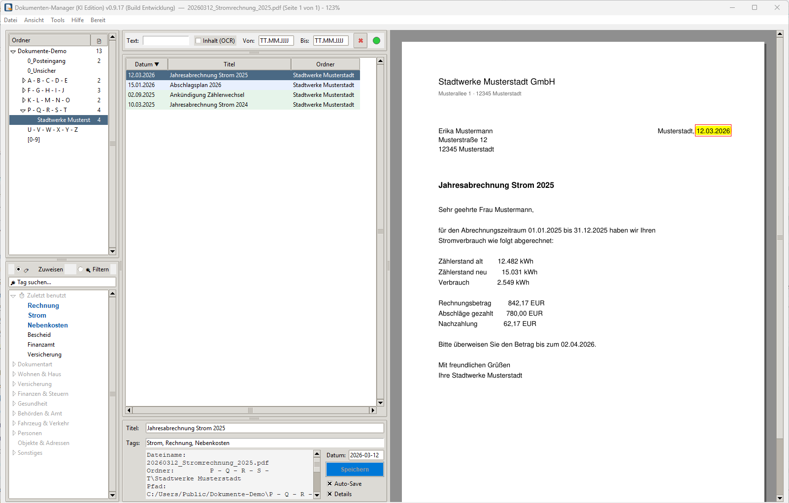

# 📄 Dokumenten-Manager (KI Edition)


Ein performantes, lokales und datenschutzfreundliches Python-Tool zur Verwaltung, Verschlagwortung und Organisation von PDF-Dokumenten. 

Diese Desktop-Anwendung (basierend auf `Tkinter` und `PyMuPDF`) wurde entwickelt, um den Workflow bei der täglichen Dokumentenablage massiv zu beschleunigen. Durch intelligente Drag-and-Drop-Mechanismen, eine hochperformante Vorschau und das direkte Einbrennen von Metadaten in die PDFs bleibt das System unabhängig von proprietären Datenbanken.

---



## ✨ Hauptfunktionen

### 🗂️ Intelligente Ordner- & Dateiverwaltung
* **Smarte Ordnerstrukturen:** Automatische Generierung von Standard-Ordnern über eine verschachtelbare `folder_default.json`.
* **Sicherer Papierkorb:** Dateien werden nicht sofort gelöscht, sondern in einen dedizierten systemweiten `-Papierkorb` verschoben, aus dem sie wiederhergestellt werden können.
* **Dateisystem-Sync:** Automatische Überwachung von Änderungen im Hintergrund.

### 🏷️ Hierarchisches Tagging-System
* **Kategorien & Vererbung:** Tags können in einem Baum strukturiert werden (z.B. *Nebenkosten -> Heizung*). Wird ein Unter-Tag ausgewählt, erbt das Dokument automatisch auch die übergeordneten Kategorien.
* **Zuletzt benutzt:** Die letzten 10 verwendeten Schlagwort-Kombinationen werden dynamisch ganz oben im Baum angepinnt für rasend schnelles Arbeiten.
* **Echtzeit-Synchronisation:** Der Tag-Baum (`tag_manager.py`) nutzt O(1) Set-Lookups, um auch bei hunderten Tags latenzfrei die visuelle Markierung an das Textfeld anzupassen.

### ⚡ High-Performance PDF-Vorschau & Suche
* **Intelligentes Caching:** Die Vorschau (`preview_manager.py`) speichert den aktuellen Render-Zustand (Pfad, Seite, Fensterbreite, Zoom). Unnötige CPU-Auslastung beim Skalieren des Fensters wird durch UI-Debouncing zu 100 % eliminiert.
* **Smart-Scroll & Animationen:** Nahtloses, vertikales Weiterblättern am Seitenende per Mausrad, ergänzt durch weiche Slide-In/Slide-Out-Animationen beim Seitenwechsel.
* **Maus-Zentrierter Zoom:** Strg + Mausrad zoomt exakt auf die Position des Mauszeigers (gedeckelt auf 500 %, um RAM-Overflows zu verhindern).
* **Virtueller Textmarker:** Das vom System oder der KI erkannte Dokumentendatum wird in der Echtzeit-Vorschau direkt auf dem PDF gelb markiert (Memory-Stream-Technik).
* **Such-Schutzschild:** Globale Suchen und Filterungen bleiben beim Anklicken der Ergebnisse erhalten, ohne dass die automatische Ordner-Navigation die Suche überschreibt.

### ⚙️ Robuste PDF-Metadaten & Inspektor
* **Direktes Einbrennen:** Metadaten (Keywords, Titel, Datum) werden physisch in das `/Info`-Dictionary der PDF-Datei geschrieben. Selbst wenn die Datei den PC verlässt, bleiben die Tags erhalten.
* **Auto-Reparatur:** Das Tool erkennt "nackte" Scanner-PDFs mit defekten Headern und baut die PDF-Struktur im Hintergrund über temporäre Dateien sauber neu auf.
* **Deep-Dive Inspektor:** Ein nicht-modales Fenster (`pdf_inspector.py`) analysiert XMP-Daten, listet eingebettete Fonts/Bilder auf und prüft, ob eine OCR-Textebene existiert.

### 🛠️ Modulares Tool-System (Plugins)
* **Dynamische Erweiterbarkeit:** Über den Ordner `src/tools/` können externe Skripte (wie PDF-Merger, KI-Titelgeneratoren oder Datenbank-Indexer) nahtlos in die App integriert werden.
* **Live-Broadcast:** Tools reagieren in Echtzeit auf Dateiauswahlen in der Haupt-App (z.B. aktualisiert sich der eingebaute *PDF-Inspektor* live, wenn man durch die Dateiliste klickt).

### ✉️ Mail-Import
* **Mail-Programm wird gefunden:** Thunderbird und klassisches Outlook stehen beim Öffnen des Fensters zur Auswahl (`mail_quellen.py`). KID arbeitet nur auf einer geprüften Kopie der Mail-Dateien und verändert am Mail-Programm nichts. .pst, .ost, mbox und .eml lassen sich auch von Hand wählen.
* **Suchen statt sortieren lassen:** Nach dem Einlesen sucht man wie im Hauptfenster („Stadtwerke 2024“, kleine Tippfehler werden verziehen) und hakt an, was in die Sammlung soll. Keine KI-Einstufung; Spam, Papierkorb und Entwürfe sind nur ausgeblendet. Auch ein Ordner mit vielen .pst- oder mbox-Dateien geht in einem Durchgang.
* **Mail als PDF:** Kopf, Text und die Original-Mail eingebettet; PDF-Anhänge werden eigene Dokumente und behalten den Bezug zu ihrer Mail. Ziel ist der Posteingang (die Vollautomatik legt sie ab wie Briefe) oder direkt ein gewählter Ordner.

### 🧭 Begleitet erfassen und Vollautomatik
* **Vollautomatik:** Beschriftet neue Dokumente aus dem Posteingang und legt sie ab, bei Zweifel in `0_Unsicher` statt still in den falschen Ordner.
* **Begleitet erfassen:** Der Posteingang Dokument für Dokument, KID schlägt vor, der Mensch bestätigt oder korrigiert. Gedacht für eine neue oder große Sammlung.

### 📖 Wiki
* **Nachschlagewerk zur Sammlung:** Einträge für Personen, Firmen, Behörden, Immobilien, Fahrzeuge, Verträge und Versicherungen in frei erweiterbaren Schubladen, mit kurzen Angaben, Verbindungen untereinander und Dokumenten als Beleg.
* **Die KI liest vor, der Mensch entscheidet:** Per Rechtsklick auf ein Dokument listet die KI auf, wer und was darin vorkommt, jede Angabe mit Zitat. Ins Wiki kommt nur, was angehakt wird. Die PDF-Dateien bleiben unverändert.

### 🖱️ Drag & Drop Workflow
* Verschiebungen in Ordner werden durch ein schwebendes, halbtransparentes Feedback-Schild am Mauszeiger visualisiert.
* **Tag-Transfer:** Zieht man ein PDF direkt auf ein anderes PDF in der Liste, werden die Tags (ohne Duplikate) blitzschnell auf das neue Dokument übertragen.

---

## 🏗️ Software-Architektur

Der Code ist streng objektorientiert aufgebaut und trennt GUI, Logik und Dateisystem-Operationen sauber voneinander:

* `main.py` / `gui.py`: Einstiegspunkt und zentraler Controller der Anwendung.
* `layout_builder.py`: Ausgelagerter Aufbau der Tkinter-UI-Elemente.
* `folder_manager.py`: Rekursives Scannen und Aufbau des Verzeichnisbaums.
* `file_operations.py`: OS-Aufrufe, Drag & Drop Handler und sicheres Verschieben/Löschen.
* `pdf_handler.py`: Statische Hilfsklasse als Brücke zu `PyMuPDF` (Rendern & Metadaten).
* `preview_manager.py`: Panning, Caching, Zoom-Mathematik und Render-Steuerung.
* `tag_manager.py` / `tag_editor.py`: Verwaltung des Tag-Baums, Kontextmenüs und `tags.json` Synchronisation.
* `tool_manager.py`: Dynamischer Plugin-Loader, der externe Skripte (wie den PDF-Inspektor) validiert und in die GUI (Menüleiste & Rechtsklick) einhängt.

---

## 🛠️ Systemvoraussetzungen & Installation

**Fertige Windows-Version (ohne Python):** Unter [Releases](https://github.com/peterm2024/Dokumenten-Manager/releases) liegt `DokumentenManager.exe` — in einen eigenen Ordner legen (die App schreibt `settings.json`, `folder_default.json`, `tags_default.json` daneben) und starten. Windows SmartScreen fragt beim ersten Start nach („Weitere Informationen → Trotzdem ausführen"), weil die Datei nicht signiert ist. Die KI-Funktionen brauchen zusätzlich einen erreichbaren Ollama-Server (siehe unten bzw. Hilfe → „KI-Server aus der Ferne").

**Aus dem Quellcode:**

1. **Python 3.x**
2. Virtuelle Umgebung anlegen und Abhängigkeiten installieren (PyMuPDF, Pillow, watchdog — Versionen siehe `requirements.txt`):
   ```bash
   python -m venv .venv
   .venv\Scripts\activate
   pip install -r requirements.txt
   ```

**Starten der App:**

```bash
python main.py

```

*Hinweis: Alle Konfigurationen (`tags.json`, `folder_default.json`, Logfiles) werden automatisch im Hauptverzeichnis der App oder im gewählten Arbeitsordner erstellt.*

**Release bauen (Entwickler):** `pip install -r requirements-dev.txt`, dann

```bash
python build_exe.py
```

Die EXE liegt danach in `dist/` — und das Skript prüft sie anschließend: jedes App-Modul aus `src/`, jedes Tool aus `src/tools/`, beide Vorlagen und die OCR-Sprachdaten müssen wirklich im Paket stecken (`python build_exe.py --pruefen` prüft eine vorhandene EXE erneut). Schlägt die Prüfung fehl, die EXE NICHT veröffentlichen. `--add-data "src/tools;tools"` ist Pflicht: der Tool-Manager lädt die Plugins zur Laufzeit aus dem Ordner, PyInstaller sieht diese Importe nicht — deshalb sammelt `--collect-submodules tools` zusätzlich alle Tool-Module samt der von ihnen importierten Projektmodule ein (ohne das fehlten in v0.9.3 zwei Tools in der EXE, FALLSTRICKE #39); die beiden `*_default.json` sind die ausgelieferten Vorlagen für Tag-Katalog und Ordnerstruktur (`app_paths.ensure_default_file` legt sie beim ersten Start neben die EXE); `tessdata` bettet die OCR-Sprachdaten ein (Neu-Erfassen, Titel-Aufräumen, Volltext-Stufe "Fortgeschritten" funktionieren so ohne Handarbeit — ein eigener `tessdata`-Ordner neben der EXE hätte Vorrang, siehe `app_paths.tessdata_dir`) Version in `help_window.APP_VERSION` hochziehen (erscheint mit dem Build-Zeitstempel der EXE in der Titelleiste und in der Hilfe), Kurzfassung in [CHANGELOG.md](CHANGELOG.md) ergänzen, Tag `v<Version>` setzen und pushen, dann `python veroeffentlichen.py v<Version> <Notizen.md> "<Titel>"`: Das Skript spiegelt den committeten Stand in den Klon des **öffentlichen** Repos `../Dokumenten-Manager-public` (peterm2024/Dokumenten-Manager), pusht ihn und legt das GitHub-Release mit der EXE dort an. Entwickelt wird in einem privaten Repo; der Spiegel lässt die privaten Arbeitsnotizen weg und bricht ab, sobald eine Datei einen Begriff aus einer privaten Liste echter Namen und Orte enthält (`python veroeffentlichen.py --probe` prüft nur, `--spiegel` spiegelt ohne Release). Im öffentlichen Repo heißt diese Datei `ENTWICKLER.md`, dessen `README.md` ist die Startseite für Nutzer.

**Optional — OCR-Titel-Aufräumen** (Tool "Titel-Aufräumen (OCR)"): PyMuPDF bringt die OCR-Engine (Tesseract) bereits mit, es fehlen nur die deutschen Sprachdaten. Einmalig `deu.traineddata` von [tessdata_fast](https://github.com/tesseract-ocr/tessdata_fast) herunterladen und nach `tessdata/deu.traineddata` legen (Ordner neben `main.py`, nicht Teil des Repos). Ohne diese Datei bleibt das Tool inaktiv, der Rest der App ist unberührt. Die Release-EXE bringt die Sprachdaten bereits mit.

**Optional — KI-Funktionen** (Titel vorschlagen, Ablage-Vorschau, Vollautomatik, Dubletten-Zweitprüfung): benötigen einen [Ollama](https://ollama.com)-Server mit einem Bild-Modell — lokal auf demselben Rechner oder auf einem anderen Gerät im Netzwerk. Server-Adresse und Modellname stehen unter Datei → Einstellungen → KI-Server (Standard `http://localhost:11434`, Modell `qwen3.5:9b`), dort gibt es auch „Verbindung testen". Keine zusätzliche Python-Abhängigkeit (reine Standardbibliothek); ist der Server nicht erreichbar, zeigt der Punkt rechts in der Suchleiste Rot, die KI-Einträge im Menü sind ausgegraut — der Rest der App ist unberührt.

**KI auf dem eigenen PC (ohne eigenen Server):**

1. Ollama für Windows von [ollama.com](https://ollama.com/download) installieren (läuft danach als Hintergrunddienst, hört nur auf diesem PC).
2. In der Eingabeaufforderung das Modell laden (einmalig, rund 7 GB): `ollama pull qwen3.5:9b`
3. Im Programm die Standardadresse `http://localhost:11434` lassen und „Verbindung testen" klicken.

Richtwerte je Dokument (eine Seite, Modell `qwen3.5:9b`) — damit niemand enttäuscht ist:

| Rechner | Dauer je Dokument | Bemerkung |
|---|---|---|
| nur Prozessor (ohne Grafikkarte) | 2 bis 10 Minuten | mind. 16 GB Arbeitsspeicher; in den Einstellungen „KI ohne Grafikkarte zulassen" ankreuzen, sonst pausiert die Vollautomatik |
| Grafik im Prozessor (integriert) | wie nur Prozessor | Ollama nutzt integrierte Grafik unter Windows in der Regel nicht |
| eigene Grafikkarte mit 8 GB | 20 bis 60 Sekunden | Modell passt gerade; bei viel Text teils im Arbeitsspeicher |
| eigene Grafikkarte mit 16 GB | 5 bis 20 Sekunden | alles im Grafikspeicher — der gedachte Normalfall |

Ohne Grafikkarte ist die KI kein Werkzeug zum Zuschauen, aber die Vollautomatik arbeitet unbeaufsichtigt — ein Stapel Scans ist dann über Nacht abgelegt. Halb so groß und schneller: Modell `qwen3.5:4b` (wie gut es Dokumente liest, ist nicht gemessen). Ein Server im Heimnetz oder aus der Ferne: Hilfe → „KI-Server aus der Ferne (Tailscale)".

---

## 🧪 Beta-Test

Wer das Programm testet, findet in [BETA_LEITFADEN.md](BETA_LEITFADEN.md) alles Nötige auf einer Seite: Einrichtung, was getestet werden soll, bekannte Grenzen und wie Rückmeldungen ankommen (Versionsnummer aus der Titelleiste plus Protokolldatei über Datei → „Protokoll-Datei (Log) öffnen").

## 📜 Lizenz

Copyright (C) 2026 Peter Metz

Dieses Programm ist freie Software unter der **GNU Affero General Public License v3.0** (siehe [LICENSE](LICENSE)): Du darfst es kostenlos nutzen, weitergeben und verändern — Veränderungen müssen bei Weitergabe (auch als Online-Dienst) wieder unter derselben Lizenz samt Quellcode verfügbar sein, und dieser Copyright-Vermerk muss erhalten bleiben. Es wird ohne jede Gewährleistung bereitgestellt.

Die Lizenzwahl folgt aus der wichtigsten Abhängigkeit: **PyMuPDF** ist AGPL-3.0-lizenziert (bzw. kommerziell bei Artifex erhältlich). Weitere Abhängigkeiten: Pillow (MIT-CMU), watchdog (Apache-2.0).

## 📚 Doku-Website (optional)

Neben dieser README gibt es eine lokal browsbare Doku-Website (mkdocs), die eure bestehenden Markdown-Dateien sowie eine automatisch aus den Docstrings generierte Modul-Referenz zusammenführt:

```bash
pip install -r requirements-dev.txt
python -m mkdocs serve
```

Danach unter `http://127.0.0.1:8000` erreichbar, aktualisiert sich live bei Änderungen.
